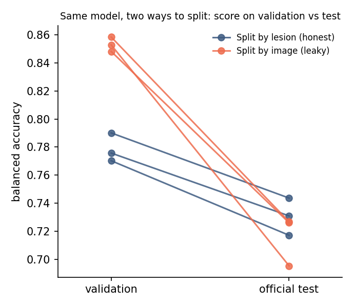
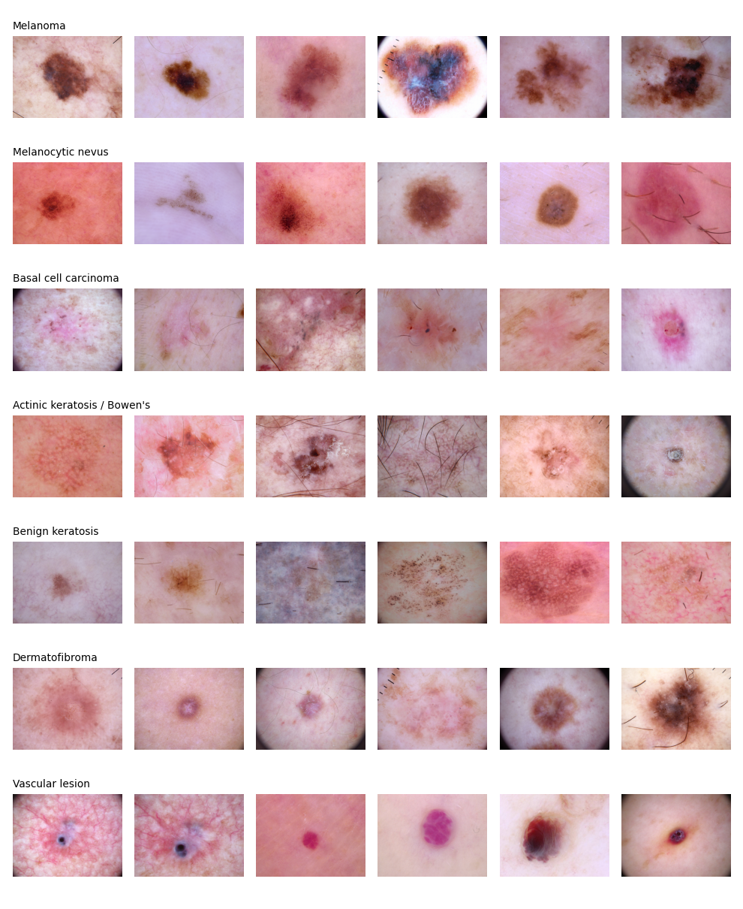
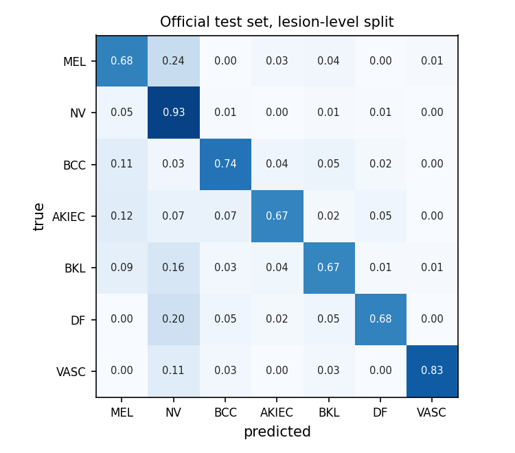
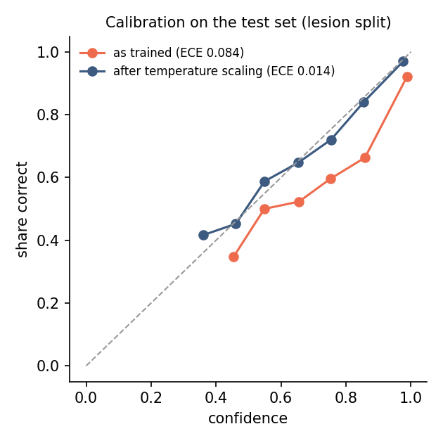

<picture><source media="(prefers-color-scheme: dark)" srcset="assets/banner-dark.svg"></picture>

# How much does a leaky split lie?

> **In one sentence:** when photos of the same mole end up on both sides of a train/validation split, the
> validation score overstates the real one by **13.7 points**, almost three times the 4.8 you get with an
> honest split, even though the model itself is no worse.

<sub>Jump to: [Background](#background-in-five-minutes) · [Results](#results) · [The model in detail](#the-model-in-detail-lesion-split-seed-42) · [How it was done](#how-it-was-done) · [Limits](#limits)</sub>

## Background in five minutes

<details open>
<summary><b>The task: telling skin lesions apart from a photo</b></summary>
<br>

Dermatologists examine suspicious spots with a **dermatoscope**, a magnifying lens with its own light that
shows the structures under the skin's surface. Photos taken through one look like the round close-ups in the
banner above. Most spots are harmless moles, but some are skin cancer, and **melanoma** is the most dangerous
common kind: caught early it's usually treatable, caught late it spreads.

**HAM10000** ("Human Against Machine with 10,000 training images") is a public collection of 10,015 such
photos, each labelled with one of 7 diagnoses, more than half of them confirmed by a biopsy. It was used for the
ISIC 2018 challenge, which also published a separate set of 1,512 test photos.

| Code | Diagnosis | In plain words | Cancer? |
|---|---|---|---|
| NV | Melanocytic nevus | an ordinary mole; two thirds of all photos | no |
| MEL | Melanoma | the dangerous one | yes |
| BCC | Basal cell carcinoma | the most common skin cancer; grows slowly | yes |
| AKIEC | Actinic keratosis / Bowen's disease | sun-damage patches that can turn into cancer | early or pre-cancer |
| BKL | Benign keratosis | harmless "age spots" and similar growths | no |
| DF | Dermatofibroma | a harmless firm bump | no |
| VASC | Vascular lesion | harmless blood-vessel spots, like cherry angiomas | no |

A model here looks at one photo and outputs a probability for each of the 7 diagnoses.

</details>

<details open>
<summary><b>How a model gets graded: textbook, mock exams, final exam</b></summary>
<br>

The photos are split into three piles, and the model only ever learns from the first:

| Pile | Like… | Used for |
|---|---|---|
| **Training** | the textbook | the model learns from these photos |
| **Validation** | mock exams | choosing settings: which training round to keep, where to put the melanoma alarm threshold |
| **Test** | the final exam, opened once | the score you report and believe |

The one rule: a model must never be graded on something it studied. A validation score is only useful if
it predicts the test score.

</details>

<details open>
<summary><b>The leak: the same mole, photographed twice</b></summary>
<br>

Many moles in HAM10000 were photographed more than once, at different angles or zoom levels:
**4,501 of the 10,015 photos (45%)** have a sibling photo of the same mole. The data comes with a lesion id
that says which photos belong together.

The usual tutorial recipe splits the photos at random. Then one photo of a mole lands in training and its
sibling in validation, and the model can score by **recognising a mole it has already seen** rather than by
diagnosing it. It's a mock exam that reuses the textbook's questions. In this data, that happened to
**41% of the validation photos**.

The fix is simple: split by **lesion**, so all the photos of one mole go into the same pile. Nothing else
changes.

</details>

<details open>
<summary><b>Why it matters</b></summary>
<br>

Every choice made on validation (which model, which training round, which alarm threshold) is made on that
number. If it's inflated, someone expects 85% and gets 72%, and a threshold tuned for "90% of healthy
patients reassured" quietly reassures fewer. Leakage between training and evaluation data is a well-documented reason
medical-imaging results fail to hold up elsewhere, so measuring one exactly seemed worth doing.

</details>

## Results



Each line is one training run, from its validation score to its score on the official test set.

**The leaky split doesn't make a worse model. It makes a validation score that lies.** Validation
overstates test balanced accuracy by **13.7 points** with the image split and by **4.8** with the lesion
split, and every leaky run overstates by more than every honest run. On the test set the two kinds of model
are indistinguishable (seed-averaged difference, 95% CI −0.027 to +0.033). So the leak doesn't hurt the
model; it hides how good the model is, and anyone choosing on that validation set is choosing on a number
that's about 9 points too optimistic.

EfficientNet-B0, ImageNet-pretrained, fine-tuned 20 epochs. Mean ± std over seeds 42, 1 and 2.
Test = official ISIC 2018 Task 3 test set, 1,512 images.

| | Split by lesion (honest) | Split by image (leaky) |
|---|---|---|
| Validation balanced accuracy | 0.779 ± 0.010 | 0.853 ± 0.005 |
| **Test** balanced accuracy | 0.731 ± 0.013 | 0.716 ± 0.018 |
| Validation − test gap | **0.048 ± 0.004** | **0.137 ± 0.018** |
| Test macro AUC | 0.958 ± 0.004 | 0.959 ± 0.006 |
| Test melanoma AUC | 0.918 ± 0.004 | 0.912 ± 0.007 |
| Melanoma sensitivity at the validation-chosen 90%-specificity threshold | 0.780 ± 0.015 | 0.780 ± 0.029 |
| …specificity it actually reached on test | 0.891 ± 0.004 | 0.863 ± 0.018 |
| Test calibration error (ECE) after temperature scaling | 0.022 ± 0.008 | 0.038 ± 0.001 |

The last two rows are the leak again, in a quieter form. A threshold chosen on the leaky validation set for
90% specificity delivers 86% on test, and the temperature fitted there calibrates worse. Anything tuned on
leaked data carries the leak with it.

Per-seed numbers, with bootstrap confidence intervals, are in [`results/`](results/):
[`seeds_summary.md`](results/seeds_summary.md), and `<run>_metrics.json` for each run.

## The leak, measured

| | |
|---|---|
| Training images | 10,015, of 7,470 lesions |
| Images whose lesion has another photo in the set | 4,501 (45%), up to 6 photos of one lesion |
| Validation images with a sibling photo in training, **image split** | 601 of 1,476 (40.7%) |
| Same, **lesion split** | 0 |
| Official test images | 1,512 |

Two thirds of the images are benign nevi, so plain accuracy would flatter any model. Everything here is
**balanced accuracy** (the mean of the per-class recalls), plus the melanoma numbers a dermatologist would
ask about: sensitivity at a fixed specificity.



## The model in detail (lesion split, seed 42)

<details>
<summary>How to read these numbers</summary>
<br>

- **Balanced accuracy:** the share of photos classified correctly *within each diagnosis*, averaged over the 7.
  Plain accuracy would be misleading here: a model that calls everything a mole would be right two thirds of
  the time.
- **AUC:** pick one photo with the disease and one without; AUC is how often the model gives the diseased one
  the higher probability. 0.5 is a coin toss, 1.0 is perfect.
- **Sensitivity / specificity:** of the real melanomas, the share the alarm catches / of the photos without
  melanoma, the share it correctly leaves alone. Moving the threshold trades one for the other.
- **Calibration (ECE):** when the model says "80% sure", is it right 80% of the time? ECE is the average gap
  between stated confidence and actual accuracy; 0 is perfect.
- **95% CI:** the range the true score probably lies in, given that the test set is only 1,512 photos.
  Computed by bootstrap: re-drawing the test set thousands of times and re-scoring.

</details>

| | |
|---|---|
| Test balanced accuracy | 0.744 (95% CI 0.704–0.780) |
| Macro AUC / melanoma AUC | 0.960 / 0.922 |
| Melanoma sensitivity, specificity | 0.795, 0.890 |
| ECE before → after temperature scaling | 0.084 → 0.014 |

<p>


</p>

The weak spot is clear in the confusion matrix: **24% of melanomas are called benign nevi**. That's the
error that matters most, and it's the main reason this is a research project and not a tool.

Temperature scaling divides every logit by one number fitted on validation. It doesn't change a single
prediction, only the confidence, and it brings "80% sure" close to "right 80% of the time".

This model is served as an API, with monitoring, in
[lesion-classifier-service](https://github.com/Janat-Yasser/lesion-classifier-service).

## How it was done

| Step | Script | What it does |
|---|---|---|
| 1 | `step1_download.py`, `step1_explore.py` | Download ISIC 2018 Task 3, count images per lesion and class, draw the gallery |
| 2 | `step2_splits.py` | Lesion split (`StratifiedGroupKFold` on lesion id) and the leaky image split, same sizes, `random_state=42`; reports how many validation images leak |
| 3 | `step3_train.py` | EfficientNet-B0, class-weighted cross-entropy, AdamW, one warm-up epoch then cosine decay, mixed precision; keeps the epoch with the best validation balanced accuracy |
| 4 | `step4_evaluate.py` | Temperature and melanoma threshold fitted on validation, then applied once to test; bootstrap 95% CIs, confusion matrix, reliability diagram |
| 5 | `step5_seeds.py` | Mean ± std over seeds, the per-seed gaps, and a paired bootstrap on seed-averaged test predictions |

```bash
pip install -r requirements.txt
python step1_download.py && python step1_explore.py
python step2_splits.py
python step3_train.py --split lesion --seed 42 --run-name lesion
python step4_evaluate.py --split lesion --run-name lesion
# ...the same for --split image and seeds 1 and 2, then:
python step5_seeds.py
```

Each run took about 28 minutes on a Colab T4. The notebooks in [`notebooks/`](notebooks/) are the exact
Colab runs: `1_train_seed42_colab.ipynb` (seed 42; it holds the first version of steps 3 and 4, before the
`--run-name` option was added) and `2_more_seeds_colab.ipynb` (seeds 1 and 2, and the summary).
`splits/` holds both splits, so they can be reused without re-running step 2.

## Limits

- One architecture and one recipe. Three seeds measure seed noise, not how other models behave.
- HAM10000 is mostly light skin. Nothing here says how the model does on darker skin.
- Dermatoscopic images only; a phone photo of skin is out of distribution.
- **Not a medical device.** Research and portfolio work only.

## Data

ISIC 2018 Challenge Task 3 / HAM10000, CC BY-NC 4.0. The images in `figures/gallery.png` come from it.

- Tschandl, P., Rosendahl, C. & Kittler, H. *The HAM10000 dataset, a large collection of multi-source
  dermatoscopic images of common pigmented skin lesions.* Scientific Data 5, 180161 (2018).
- Codella, N. et al. *Skin Lesion Analysis Toward Melanoma Detection 2018: A Challenge Hosted by the
  International Skin Imaging Collaboration (ISIC).* arXiv:1902.03368 (2019).

© 2026 Janat Yasser. All rights reserved. See [LICENSE](LICENSE).
